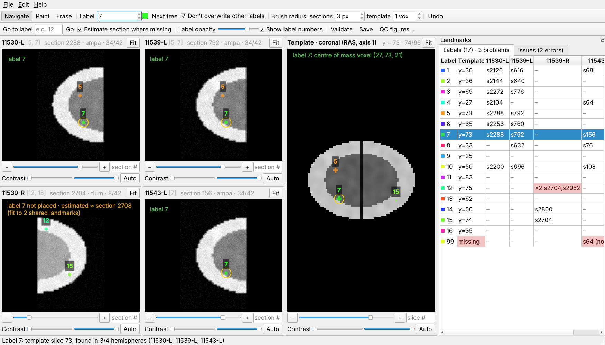

# Landmark labelling GUI

Label corresponding landmark points on coronal autoradiograph stacks and on a
3-D reference MRI, so BrainBuilder can initialise the 2-D/3-D alignment from
them.

Each hemisphere stack gets its own pane, and one pane shows the coronal slices
of the template with its existing 3-D landmarks. Label values are shared
between all panes: **the same number is the same anatomical point** in every
hemisphere and in the template.



## Files

| file | what it is |
|---|---|
| `landmark_gui.py` | the GUI |
| `landmark_qc.py` | QC figures (also run from the GUI's **QC figures…** button) |
| `landmark_core.py` | reading/writing, label statistics, validation, saving (no Qt) |
| `make_section_csv.py` | builds the input CSV from autoradiograph file names |
| `make_synthetic_data.py` | small fake dataset to try everything |
| `test_landmark_core.py` | tests (`python -m pytest test_landmark_core.py -q`) |

## Install

Python ≥ 3.9.

```bash
pip install -r requirements.txt
```

## Input CSV

One row per section. `make_section_csv.py` builds it from file names like
`mr#rh#11530#L#musc#5768#37#L_crop.nii.gz`. In that example the subject is
`11530`, the hemisphere `L`, the ligand `musc` and the section number `37`.
Existing labels are matched as `<image name>_landmark.nii.gz` in the labels
folder:

```bash
python make_section_csv.py --root /data/macaque --images preprocessed --labels v1.3 \
    --out /data/macaque/landmark_sections_v1.3.csv
```

Column names are matched case-insensitively. Any of the names below work, or
pass `--col-sub`, `--col-hemi`, `--col-section`, `--col-raw` or `--col-labels`.

| role | accepted names |
|---|---|
| subject | `sub`, `subject`, `specimen`, … |
| hemisphere | `hemisphere`, `hemi`, `side` |
| section number | `section`, `sample`, `section_number`, … |
| autoradiograph path | `raw`, `autoradiograph`, `image`, `filepath`, … |
| section label path | `labels`, `label`, `landmark`, `landmarks`, `section_labels`, … (optional; empty cell = no labels yet) |
| ligand (optional, shown in the pane) | `ligand`, `acquisition` |
| chunk (optional, sorts sections) | `chunk`, `slab` |

- **Specimen IDs** are `<subject>-<hemisphere>`, e.g. `11530-L`. A `sub-`
  prefix on the subject is dropped.
- **Relative paths** are resolved against the CSV's folder.
- **Formats.** Autoradiographs can be 2-D NIfTI or PNG/TIFF.
- **Existing label images** must have the same shape as their autoradiograph.
  A mismatch stops the program at start-up rather than silently dropping
  labels.

## Run

From the folder that holds `preprocessed/` and `v1.3/`:

```bash
python landmark_gui.py \
    --csv landmark_sections_v1.3.csv \
    --template MEBRAINS_T1.nii.gz \
    --template-labels v1.3/MEBRAINS_L_landmarks_v1.3.nii.gz \
    --out-dir v1.4 \
    --specimens 11530-L 11539-L 11539-R 11543-L \
    --flip-lr 11539-R
```

`--specimens` picks the stacks and their pane order (default: every specimen in
the CSV, in order of appearance). `--flip-lr` shows the listed specimens'
sections mirrored left-right, so a right hemisphere reads like the left ones;
its pane and QC panels are titled e.g. `11539-R-flipped-lr`. This is display
only: clicks map back through the mirror, and label files keep the original
orientation of the autoradiographs. The choice is remembered for `--resume` and
the QC script. The coronal axis of the template is read from
its affine; override it with `--coronal-axis 0|1|2`. If `--template-labels`
doesn't exist yet, you start with an empty label volume.

### Where things are saved

- **No edits, no output.** If you don't change any annotation, nothing is
  written and no folder is created. Editing and then undoing back to the loaded
  state also counts as no change. Browsing, *Go to label* and *Validate* never
  write.
- **The output folder is created on the first save that has edits.** A new
  CSV pointing at the new label files is always written with them.
- **Existing folders are never overwritten silently.** If `--out-dir` already
  contains files, the first save asks: **Choose another folder…**,
  **Overwrite**, or **Cancel**. `--overwrite` skips the question. Autosave never
  writes into such a folder by itself.
- **After the first save, the folder belongs to the session.** Later saves
  (manual, or autosave every 5 minutes, see `--autosave-min`) go to the same
  folder without asking.
- **Inputs are never modified,** unless you point `--out-dir` at their folder
  and choose to overwrite.
- **Deletion.** Only files this tool wrote itself are ever deleted, e.g. a
  section's label file after you erased all its labels. Any other file is left
  in place and listed in `validation_report.txt`.

**Continuing later.** Either load the saved labels and write a new version
folder:

```bash
python landmark_gui.py --csv v1.4/landmark_sections_v1.4.csv \
    --template MEBRAINS_T1.nii.gz --template-labels v1.4/MEBRAINS_L_landmarks_v1.4.nii.gz --out-dir v1.5
```

or keep working in the same folder with `--out-dir v1.4 --resume --overwrite`.
If `--out-dir` holds a saved session and you didn't pass its CSV, the GUI asks
whether to load it.

## Using it

**Each pane** has:
- a slider, `−`/`+` buttons (one section back/forward), and a box to type a
  section number. In stacks with several chunks, `chunk:section` also works.
  If the number isn't in the stack, the pane jumps to the nearest section and
  tells you.
- **Contrast** sliders (percentiles of the section's intensities, so they adapt
  across ligands), plus **Auto** to reset them.

Hovering over a label shows its number; the status bar shows the pixel/voxel,
its intensity and world coordinates (template). Every label also carries a
number tag (toggle **Show label numbers**).

**Go to label** (toolbar box, or click a row in the **Labels** table):
- moves the template to the coronal slice through the label's centre of mass
  (rounded to the nearest integer) and rings it;
- moves every hemisphere that has the label to that section and rings it;
- hemispheres without the label stay where they are and say so;
- if the label isn't in the 3-D template, it says so and does nothing else;
- it also makes that label the current painting label.

Optional **Estimate section where missing** jumps hemispheres that lack the
label to the section predicted by a linear fit of section number against
template coronal position, using the landmarks they already share. It needs at
least two shared landmarks and a single chunk.

### Mouse

| action | effect |
|---|---|
| wheel, right-drag | zoom |
| left-drag (Navigate mode), middle-drag (any mode) | pan |
| left click/drag in **Paint** mode | paint the current label (brush radius in px for sections, voxels for the template; template painting is on the current coronal slice) |
| left click/drag in **Erase** mode | erase any label under the brush |
| **Shift+click** (Paint) | *move* the current label here: it is removed from every other section of this hemisphere (or elsewhere in the template), so it stays unique |
| **Ctrl+click** | make the label under the cursor the current label |

With **Don't overwrite other labels** ticked (the default), painting never
changes another label's pixels.

### Keys

| key | action |
|---|---|
| `P` / `E` / `N` (`Esc`) | Paint / Erase / Navigate mode |
| `←`/`↑`, `→`/`↓` | previous / next section in the pane under the mouse |
| `[` / `]` | brush smaller / larger |
| `F` | fit the pane under the mouse |
| `Ctrl+G` | go to the "Go to label" box |
| `Ctrl+Z` | undo |
| `Ctrl+S` | save |

**Next free** sets the current label to one more than any label in use, for
adding a new landmark.

## Rules that are checked

**Validate** (and every save) checks:

1. **Unique in the template.** Each label is one connected blob in 3-D
   (26-connectivity).
2. **Unique per hemisphere.** Each label is in only one section, as one blob
   (8-connectivity).
3. **Every hemisphere label exists in the template.** The reverse is not
   required: template points may be absent from a hemisphere.
4. **Two warnings for BrainBuilder.** Raw file names that are prefixes of each
   other are flagged, because BrainBuilder's `{root}*.nii.gz` glob would match
   two files. Two sections with the same file name are an error.

Problems appear in red in the **Labels** table and are listed in the
**Issues** tab; clicking an issue takes you to it. Saving always works (work in
progress is never lost), but a hemisphere's 3-D file is only written when that
hemisphere passes (see below).

## Outputs (`--out-dir`)

The layout is flat and named like your existing landmark folders, so `v1.4/`
looks like `v1.3/`. The version tag is the folder name when it looks like
`v1.4`; set it with `--version-tag`, or leave it out for a plain name.

| file | contents |
|---|---|
| `<image name>_landmark.nii.gz` | 2-D labels for every section that has any. Same shape/layout as the autoradiograph; NIfTI copies its header/affine. The suffix is set by `--label-suffix`. `--label-format match` (default) writes NIfTI for NIfTI images and 16-bit PNG for PNG images. |
| `landmark_sections_v1.4.csv` | **the new CSV**: your input CSV with the label column pointing at the new files (empty = no labels); paths are relative to this folder |
| `MEBRAINS_L_landmarks_v1.4.nii.gz` | all 3-D labels, original and new. The name comes from `--template-labels` with its version replaced. |
| `11530_L_landmarks_v1.4.nii.gz`, … | per hemisphere: only the 3-D labels that hemisphere also has, so the 2-D↔3-D mapping is strictly one-to-one. Written only when that hemisphere has no validation errors. |
| `landmark_table.csv` | one row per label per space: centre of mass (voxel and mm), section, voxel count, blob count |
| `landmark_coverage.csv` | label × space matrix |
| `validation_report.txt` | the last validation |
| `qc/` | QC figures (with nothing saved, the QC button asks where to put them) |
| `session.json`, `gui_state.json` | for resuming: inputs, columns, files written, pane positions, contrast, brush sizes |

The per-hemisphere 3-D files are regenerated from the template label volume
each time; existing per-hemisphere files (e.g. `v1.3/11530_L_landmarks_v1.3.nii.gz`)
are not read.

## QC figures

One page per label. The template's coronal slice through the label sits next to
the section holding it in each hemisphere. The top row shows whole sections with
a crosshair, to compare anatomical position at a glance; the bottom row zooms
in. Missing labels get an empty panel, and problems are written in the panel
title. Page 1 is the coverage table.

```bash
python landmark_qc.py --out-dir v1.4                  # all labels of a saved session
python landmark_qc.py --out-dir v1.4 --labels 3 12    # some
```

## BrainBuilder

- **2-D landmarks.** Use the output folder (e.g. `v1.4/`) as the landmark directory.
  BrainBuilder finds each section's file with `{raw_root}*.nii.gz`, so the
  labels must be NIfTI. That happens automatically when the CSV's
  autoradiographs are BrainBuilder's NIfTI files; otherwise use
  `--label-format nifti`.
- **3-D landmarks.** Use `<sub>_<hemi>_landmarks_<tag>.nii.gz` as that
  hemisphere's `ref_landmark` in `chunk_info`.
- **Pixel layout.** Label files have exactly the pixel layout of the image
  referenced in the CSV. If BrainBuilder reads a different file (e.g. a NIfTI
  converted from these PNGs), convert the labels the same way, with
  nearest-neighbour interpolation.

## Try it

```bash
python make_synthetic_data.py demo
python landmark_gui.py --csv demo/sections.csv --template demo/template.nii.gz \
    --template-labels demo/template_landmarks.nii.gz --out-dir demo/out
```

The demo has two planted problems for the checks to find: a label placed in two
sections of 11539-R, and a label 99 in 11543-L with no template counterpart.

## Notes

- **Orientation.** Images are shown as stored (except specimens given to
  `--flip-lr`): PNG/TIFF row 0 at the top; 2-D NIfTI with x left→right and
  y bottom→top, like BrainBuilder's QC plots.
  The template's coronal slice is shown neurological (subject left on the
  left) and superior up, from its affine. Nothing is flipped or rotated on
  disk, and no orientation is recorded.
- **What BrainBuilder uses.** It only uses each landmark's centre of mass, so
  a small disk (default radius 3 px; 1 voxel in the template) is enough.
- **Large images.** Tested at 3120×4164 px per section: about 0.2–0.4 s to
  change section, under 0.1 s per click.
